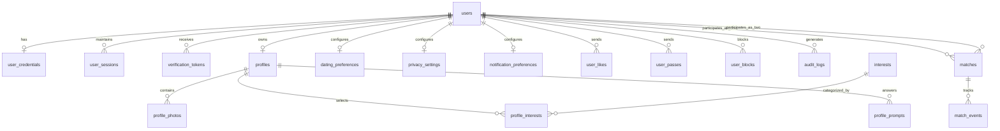
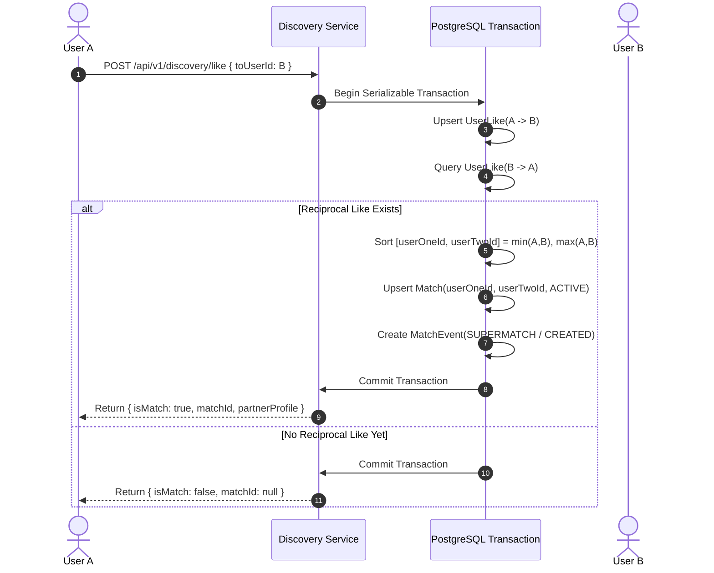

# PairUp Platform — Core Backend Architecture & System Design

**Author:** Member 1 (Platform Technical Lead & Architect)  
**Modules Owned:** Authentication, User Profiles, Discovery & Matching, Safety & Moderation, Database Architecture, Integration Contracts.  
**Tech Stack:** NestJS, TypeScript, PostgreSQL, Prisma ORM, Redis, Jest, Supertest, Docker Compose, Swagger/OpenAPI.

---

## 1. Executive Summary & System Overview

PairUp is an AI-powered dating and relationship platform built on clean architecture, modular domain boundaries, and high-concurrency transaction safety.

The platform is developed by a four-member engineering team:
- **Member 1 (Lead / You):** Platform Architecture, Core Backend, Authentication, Profiles, Matching, Database & Safety.
- **Member 2:** Web & Mobile Frontend Client Applications.
- **Member 3:** Real-time Messaging, WebSockets, Audio/Video Calling.
- **Member 4:** AI Recommendation Engine (Vector Embeddings) & Content Moderation Screening.

```mermaid
flowchart TD
    Client["Clients: Web & Mobile (Member 2)"] -->|REST /api/v1| Gateway["NestJS Core API Gateway (Member 1)"]
    Client -->|WebSockets / WSS| ChatGateway["Real-time Chat & Calls (Member 3)"]

    Gateway --> AuthModule["Auth & Accounts Service"]
    Gateway --> ProfileModule["Profile & Preferences Service"]
    Gateway --> DiscoveryModule["Discovery & Matching Service"]
    Gateway --> SafetyModule["Safety & Moderation Service"]

    ChatGateway -.->|canUsersCommunicate()| MatchContract["Match Permission Interface (Member 1)"]
    DiscoveryModule -.->|rankCandidates()| AIContract["AI Recommendation Provider (Member 4)"]
    SafetyModule -.->|inspectContent()| ModerationContract["AI Moderation Pipeline (Member 4)"]

    AuthModule --> Redis[("Redis: Caching & Rate Limiting")]
    Gateway --> Postgres[("PostgreSQL: Prisma ORM")]
```

---

## 2. Core Domain Architecture & Boundaries

The backend strictly separates domain logic from transport controllers, organizing code into distinct, loosely-coupled modules:

| Module | Responsibility | Primary Boundaries |
| :--- | :--- | :--- |
| **AuthModule** | Registration, credential validation, JWT token issuance, refresh-token rotation, lockout, session management, email verification. | `User`, `UserCredential`, `UserSession`, `VerificationToken` |
| **UsersModule** | Account lifecycle, password changes, deactivation, and administrative status enforcement (suspend, ban). | `User`, `AccountStatusHistory`, `AuditLog` |
| **ProfilesModule** | Detailed profile CRUD, photo gallery, conversation prompts, interest taxonomy, dating search preferences, and privacy rules. | `Profile`, `ProfilePhoto`, `Interest`, `ProfileInterest`, `ProfilePrompt`, `DatingPreference`, `PrivacySetting` |
| **DiscoveryModule** | Candidate feed generation, distance calculation, exclusion filtering, like/pass swiping actions, and mutual-match detection. | `UserLike`, `UserPass`, `Match` |
| **MatchesModule** | Active match listings, cursor pagination, match event history, unmatching, and real-time communication permission verification. | `Match`, `MatchEvent` |
| **SafetyModule** | User blocking, safety reporting, administrative audit log inspection, and content safety flags. | `UserBlock`, `AuditLog` |
| **IntegrationsModule** | Standardized cross-module contracts and TypeScript interfaces for Members 2, 3, and 4. | `IMatchPermissionService`, `IRecommendationProvider`, `IModerationService` |

---

## 3. Database Architecture & Entity Relationships

The PostgreSQL schema uses UUIDs for all entity identifiers, cascading foreign-key constraints where lifecycle ownership is strict, and composite unique indexes to guarantee data integrity.



### Key Relational Safeguards
1. **Canonical Match Ordering:** Matches enforce `userOneId < userTwoId` lexicographically with a unique constraint `@@unique([userOneId, userTwoId])`. This mathematically guarantees that no pair of users can ever produce duplicate or conflicting match rows, even under concurrent mutual likes.
2. **Deterministic Deletion & Soft Deletes:** Account deactivation marks `status = DELETED` and sets `deletedAt`, revoking active sessions without breaking relational historical data.
3. **Session Revocation & Blacklisting:** Logout or password resets immediately mark DB sessions `isRevoked: true` and write the current access token to Redis with a TTL matching token lifetime.

---

## 4. Matching Engine & Concurrency Control

### Transaction-Safe Like & Match Workflow
When User A likes User B:
1. Validates that `User A != User B` and User B is `ACTIVE` and not blocked.
2. Executes a Prisma database transaction:
   - Upserts `UserLike(from: A, to: B)` (idempotent).
   - Deletes any prior `UserPass(from: A, to: B)` if User A previously passed.
   - Checks for reciprocal like: `UserLike(from: B, to: A)`.
   - If found:
     - Orders IDs: `[userOneId, userTwoId] = [A, B].sort()`.
     - Upserts `Match` with `status: ACTIVE`.
     - Inserts `MatchEvent(CREATED or SUPERMATCH)`.
     - Returns `{ isMatch: true, matchId, partnerProfile }`.
   - If not found:
     - Returns `{ isMatch: false, matchId: null }`.



---

## 5. Security & Authentication Architecture

1. **Password Security:** Passwords hashed with `bcrypt` (10 rounds). Plaintext passwords and secrets are never logged or stored.
2. **Account Lockout Policy:** 5 consecutive failed login attempts locks the account for 15 minutes, mitigating brute-force and credential-stuffing attacks.
3. **Refresh Token Rotation (RTR):**
   - Refresh tokens are opaque, high-entropy cryptographic strings.
   - Hashes (`SHA-256`) are stored in `user_sessions`.
   - On refresh, the used token is revoked and a new token issued.
   - **Reuse Detection:** If a previously revoked refresh token is presented, the system treats it as token theft and revokes all active sessions for that user family.
4. **Anti-Enumeration:** Registration and password recovery endpoints return generic, privacy-preserving responses so attackers cannot discover if an email exists on the platform.
5. **Auditing:** Sensitive events (`REGISTER`, `LOGIN_FAILED`, `PASSWORD_RESET`, `ACCOUNT_SUSPENDED`, `USER_BLOCKED`) are recorded in `audit_logs` with IP and User-Agent.

---

## 6. Performance & Scalability Strategy

- **Geospatial & Filtering Optimization:** Indexed composite coordinates `[latitude, longitude]`, `birthDate`, and `gender` on `profiles`.
- **Cursor-Based Pagination:** Discovery feeds and match listings use cursor-based keyset pagination instead of high-offset SQL queries.
- **In-Memory Fallback:** The Redis client includes automatic graceful degradation to an in-memory TTL store if Redis becomes unreachable in test or low-resource environments.
